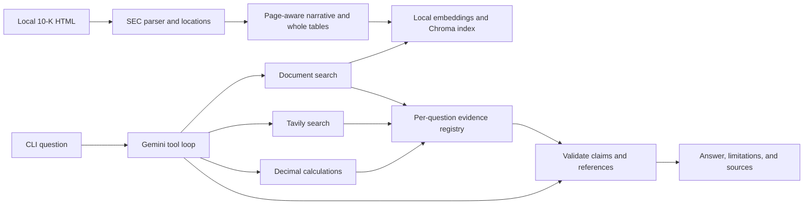

# Architecture

The application researches a configured Apple 10-K HTML file. Local retrieval supplies
filing evidence; Gemini selects tools and drafts a structured answer; Tavily supplies
external evidence when the question needs it. Financial arithmetic stays in Python.

## Data flow

## Module ownership

| Location | Responsibility |
| --- | --- |
| `src/main.py` | CLI, explicit index building, configuration, and per-question composition |
| `src/agent.py` | Gemini interaction loop, tool dispatch, retries, final JSON validation, and rendering |
| `src/tools/document_qa.py` | Register retrieved chunks and numeric facts as evidence; expand internal references |
| `src/tools/tavily_search.py` | Fetch web results and register supported numeric metrics |
| `src/utils/parser.py`, `locations.py` | Read HTML or saved MHTML, normalize tables, identify sections, pages, and references |
| `src/utils/chunker.py` | Split narratives within pages; preserve complete tables and their metadata |
| `src/utils/index.py` | Local embedding interface, Chroma persistence, compatibility manifest, and bounded reference traversal |
| `src/utils/evidence.py`, `calculator.py` | Evidence/fact/calculation identity and deterministic arithmetic |
| `src/utils/config.py`, `logging.py` | Environment settings and log setup |
| `prompts/` | Runtime response format, evidence policy, tool guidance, and examples |
| `scripts/`, `.githooks/`, `.agents/skills/` | Development commands, Git checks, and coding-assistant workflows |

## Index lifecycle

Index mode reads the filing, extracts metadata, embeds chunks, and persists Chroma data
with an `IndexManifest`. Compatibility depends on the source hash, embedding model,
chunk size/overlap, and `Settings.chunking_version`. When extraction or metadata changes,
bump that version and rebuild explicitly. Query mode rejects stale manifests.

The sentence-transformer loader uses `local_files_only=True`: the embedding model must
already be cached. Adding a package does not download that model. Chroma and the manifest
are generated artifacts excluded from Git.

## Answer lifecycle and boundaries

The CLI creates fresh tools and an `EvidenceRegistry` for each question. Gemini can call
`search_documents`, `search_web`, and `calculate_financial_metric`. Tool results preserve
call IDs, and the model continues through interaction IDs. A bounded final synthesis step
delivers the last tool results when the research budget is exhausted.
If an earlier final answer is not valid JSON, the agent makes one tool-free formatting
request linked to that interaction. Final synthesis and formatting requests enforce a
JSON response schema; their output still passes the local evidence validator. A second
malformed response fails without another formatting request.

Final JSON contains `claims`, `calculation_ids`, and `limitations`. Narrative claim
text must occur verbatim (normalized whitespace and case) in each cited excerpt.
Narrative claims that fail this check are omitted with an explicit limitation while
supported claims are preserved. Unknown citations and invalid calculations still fail.
Registered numeric fact IDs used as citations resolve to their parent evidence IDs
and are deduplicated before validation. Unregistered IDs are never inferred from their
spelling; calculation claims still require exactly their registered input sources.
Calculation claims link `calculation_id` and cite exactly its recursively resolved
input sources. Rendering ignores calculation claim prose and uses registry values,
formulas, and reporting periods, with automatic cross-period/unknown-period caveats.
This establishes text presence and calculation provenance, not source reliability or
contextual completeness. Missing evidence can produce a limitations-only answer.
The loop defaults to twelve research rounds plus final synthesis. Provider and tool
transient failures receive bounded backoff; permanent errors do not retry. Gemini
requests receive five attempts, with waits of 2, 4, 8, and 16 seconds plus 0–1 second
of random jitter per wait, including final synthesis. Tool calls retain three attempts.
Identical model calls are blocked after success or exhausted retries.

Web numeric extraction supports only unambiguous annual prose percentages with an
explicit fiscal year in the metric's sentence. Publication dates are not reporting
periods. Ambiguous, quarterly, and cloud-segment metrics remain excerpt-only evidence.

Printed pages and real anchors come from HTML metadata. Missing page labels use section
citations. Internal notes and links are followed with depth and chunk limits; traversal
does not fetch external linked documents. See `follow_references` for the current limits.

Calculations resolve fact IDs or calculation IDs rather than accepting numbers supplied
by the model. Preserve existing checks for zero denominators, units, and periods. Company
comparisons may span reporting periods, which the final answer must disclose.

## Validation

The offline suite uses fixture HTML, fake providers, and a deterministic test embedder.
It covers retrieval/persistence, table and page relationships, citations, calculations,
and failure paths. One parser regression also reads the bundled fiscal-2025 filing.
The `gemini_integration` marker is a separate opt-in provider contract test; its success
does not prove both demo queries work end to end. Commands live in [docs/COMMANDS.md](docs/COMMANDS.md).
